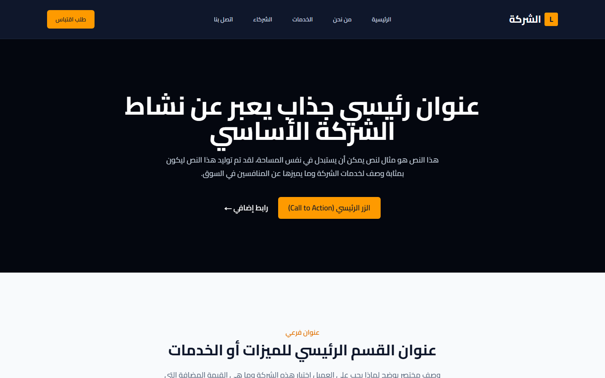

# Corporate B2B Website Template (Arabic, RTL)

A ready-to-brand corporate website for B2B companies, in Arabic and right-to-left. Every page uses placeholder text, so a new client site only needs its name, colours and copy. Built with Next.js and Tailwind CSS and exported as a static site on GitHub Pages.

**Live demo:** https://ahmed-hebila.github.io/corporate-b2b-demo/


| Desktop | Mobile |
| --- | --- |
|  |  |

## Pages

- **Home** — hero with a call to action and a features / services section
- **About** (`/about`) — company story, vision, mission and values
- **Services** (`/services`) — service cards with details
- **Partners** (`/partners`) — success partners and a “become a partner” call to action
- **Request a quote** (`/quote`) — quote form for B2B leads
- **Contact** (`/contact`) — contact form, emails, phones and a Google Map

## Highlights

- Arabic RTL layout with a sticky header, mobile menu and footer
- One config file for the company details: `src/config/site.js` (name, logo letter, description, emails, phones, address, map, social links)
- Contact and quote forms with required fields and sending / success states, ready to connect to an API or email service
- Static export (`output: 'export'`) deployed by a GitHub Actions workflow to GitHub Pages

## Project structure

```
src/
├── app/
│   ├── page.js                 # home
│   ├── about/  services/  partners/
│   ├── quote/QuoteForm.js      # quote request form
│   └── contact/ContactForm.js  # contact form
├── components/layout/          # Header, Footer
└── config/site.js              # company details used across the site
```

## Run locally

```bash
npm install
npm run dev
```

Open http://localhost:3000. `npm run build` creates the static site in `out/`.

## Make it yours

1. Edit `src/config/site.js` with the company's details.
2. Replace the placeholder text in the pages under `src/app/`.
3. Change the accent colour in the Tailwind classes (amber by default).

## Author

**Ahmed Hebila** — Flutter & Node.js developer
[Portfolio](https://ahmedhebila.vercel.app) · [LinkedIn](https://www.linkedin.com/in/ahmed-hebila) · [GitHub](https://github.com/Ahmed-hebila)
